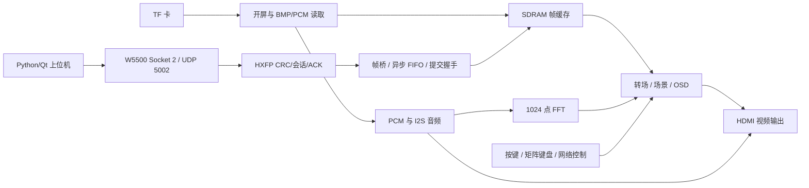

# 工程结构与接口

顶层 `src/user_source/hdl_source/top_tf_hdmi_audio.v` 的模块名为 `top`，器件 EG4S20BG256。可从 TD 工程的 Source_Files 找到实际参与构建的模块；`fpga_upload/rtl/hxfp_receiver.v` 是 donor 参考版本，正式集成接收器位于 `src/user_source/hdl_source/network/hxfp_receiver.v`，联合仿真也使用正式版本。

## 模块索引

| 模块目录/文件 | 作用 |
|---|---|
| `SD/` | TF SPI、BMP 扫描、SDRAM 与帧读写 |
| `boot_video_stream.v`、`boot_video_play.v` | BVP1 开屏数据读取、双缓冲与播放 |
| `audio_pcm_raw_reader.v` 等 | AUDP 数据读取、PCM FIFO 和音频选择 |
| `network/w5500_image_udp.v` | Socket 2 图片 UDP 传输及环形缓冲处理 |
| `network/hxfp_receiver.v` | 报文 CRC、会话、重传、像素提交协议 |
| `network/hxfp_frame_bridge.v` | 离屏缓冲所有权、流控、排空与显示提交 |
| `network/w5500_http_ctrl.v`、`w5500_udp_ctrl.v` | HTTP 网页及控制 UDP |
| `scene_*`、`transition_*`、`subtitle_osd*` | 场景控制、转场和字幕叠加 |
| `spectrum_*` | 实时 FFT 与频谱显示；历史 assets/spectrum-animation 不代表最终使用预制频谱 |
| `desktop/fpga_transfer.py` | HXFP 图片转换、分包、重传、最终显示确认 |
| `desktop/core.py`、`tools/m3_telemetry.py` | 串口状态解析、记录、导出 |

## 引脚与外设

以 `src/user_source/constraints_source/pin.adc` 为正式定义。本次从其非注释语句提取了 `docs/pin-map.csv`，包含信号、封装引脚和电气配置；这不是新绘制的原理图，也不证明外部模块接线。

主要入口：系统时钟 R7、低有效复位 A2、key1 B2、key2 C1、事件按键 B1、UART TX D12。矩阵键盘行 P4/N4/N3/M5、列 M3/M4/L3/J3。W5500 的 INT/SCLK/RST/CS/MOSI/MISO 分别为 J4/H4/N1/M2/M1/L1。TF SPI 和 HDMI 差分/控制线以完整约束文件为准；不要把封装焊球编号当作排针序号。

## 数据约定

- 显示帧 640×480；图片上传为 RGB565 LE，614400 字节，最多每包 1024 字节。
- HXFP 头为 20 字节，CRC32 覆盖前 16 字节与 payload；固定头字段大端，像素值小端。精确字节布局见 `fpga_upload/PROTOCOL.md`。
- `DATA ACK` 只表示已接受的数据进度；`COMMIT/DISPLAYED` 经过内存排空及帧边界确认，不能把收齐像素等同已经上屏。
- TF BMP 扫描不是通用 FAT32 读取器。顶层扫描扇区 0…131071；AUDP 起点 48256；BVP1 起点 262144。前两者落在同一扫描区，介质布局必须明确规划，不能盲写。
- AUDP 头：`AUDP` + version 1 + song count 3，偏移 8 起每首两个 little-endian u32：绝对起始扇区、PCM 字节长度；PCM 为 48 kHz 双声道 signed 16-bit LE，无 WAV 头。
- BVP1 头：魔数 `BVP1`，偏移 4/6 为 LE u16 宽/高，偏移 12 为帧数，偏移 16 为 LE u32 每帧字节数；512 字节头后接 320×240、底向上 RGB565 帧。

没有原演示镜像时，不承诺复制素材文件即可复现相同开屏和歌曲。
